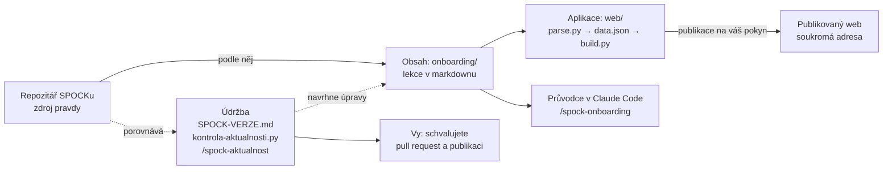

# Architektura SPOCK Tutorialu

Z čeho se tutoriál skládá, kudy teče změna od SPOCKu až na web a které části mění každá úprava. Každý pull request uvádí, kterých vrstev se týká.

## Jak to do sebe zapadá

Jediný zdroj obsahu jsou lekce v markdownu. Web i průvodce v Claude Code z nich čtou. Údržba hlídá, aby lekce odpovídaly SPOCKu.

Plné šipky: kudy teče obsah. Čárkované: údržba, která hlídá aktuálnost vůči SPOCKu.

## Čtyři vrstvy

| Vrstva | K čemu | Soubory |
|---|---|---|
| **Obsah** | Co se učí. Mění se nejčastěji. | `onboarding/*.md`: úrovně 0–4 a moduly rolí PM, PD, SWE, GM; tahák, slovník, diagnostika, zásady, připravenost; `POKROK.md` pro průvodce v Claude Code |
| **Aplikace** | Jak se to ukazuje. Web ve stylu Duolinga. | `web/parse.py` čte lekce, `web/build.py` skládá stránku; `app.js` (cesta, lekce, kvízy, odznaky, chat se Spockem); `sim.js` (simulace SPOCK nanečisto, vysvětlivky, dotazník); `*.css`, `media/`. Návod v [web/README.md](web/README.md) |
| **Údržba** | Aby tutoriál nezastaral, když se SPOCK mění. | [SPOCK-VERZE.md](SPOCK-VERZE.md): vydání a commit SPOCKu; `nastroje/kontrola-aktualnosti.py`: mechanická kontrola odkazů a změn; `/spock-aktualnost`: měsíční kontrola v Claude Code |
| **Průvodci** | Kdo uživateli pomáhá. | `/spock-onboarding`: průvodce v Claude Code, zapisuje pokrok; Spock na webu: chat, který zná všechny lekce |

## Kudy jde která změna

Každá změna jde na vlastní větev a do pull requestu. Do hlavní větve se sloučí až po schválení. Web se publikuje zvlášť.

| Co se mění | Vrstva a kde | Co následuje |
|---|---|---|
| Text lekce, úkol, kvíz | Obsah: `onboarding/*.md` | Sestavit web, publikovat. Nový úkol jen na konec lekce. |
| Vzhled nebo funkce webu | Aplikace: `web/app.js`, `sim.js`, `*.css` | Sestavit web, otestovat počítač, mobil a tmavý režim, publikovat. |
| Simulace, vysvětlivky pojmů, popisy rolí | Aplikace: `sim.js`, `app.js` | Texty jsou mimo markdown, proto je hlídá i měsíční kontrola. |
| Nové vydání SPOCKu | Údržba: `/spock-aktualnost` | Zpráva se závažností, schválení, úprava lekcí, nový zápis v `SPOCK-VERZE.md`. |
| Chování průvodce v Claude Code | Průvodci: `.claude/skills/` | Platí od dalšího spuštění v Claude Code. |

## Pravidla, která drží tutoriál v pořádku

1. **Obsah se mění jen v markdownu.** Web se z něj sestavuje, HTML se ručně neupravuje.
2. **Nový úkol na konec lekce, nová lekce na konec modulu.** Pořadí úkolů je klíč uloženého pokroku uživatelů.
3. **Každé tvrzení o SPOCKu má oporu ve SPOCKu.** Odkazy kontroluje skript, chování se ověřuje spuštěním tasků na kopii SPOCKu.
4. **Nic se neslučuje ani nepublikuje bez schválení.** Větev, pull request, schválení, pak sloučení.
5. **Web je soukromý.** Otevře ho jen ten, s kým ho vlastník sdílí z menu stránky. Pokrok se ukládá jen v prohlížeči uživatele.

## Historie změn

S každým sloučeným pull requestem sem přibude řádek: číslo, vrstvy a co se změnilo.

| PR | Vrstvy | Co se změnilo | Sloučeno |
|---|---|---|---|
| [#9](https://github.com/TominoHav/SpockTutorial/pull/9) | Údržba | Tento dokument o architektuře tutoriálu | 14. 11. 2026 |
| [#8](https://github.com/TominoHav/SpockTutorial/pull/8) | Obsah, Aplikace | Vysvětlení architektury SPOCKu v lekci GM 2G.6 a schéma na webu | 14. 11. 2026 |
| [#7](https://github.com/TominoHav/SpockTutorial/pull/7) | Aplikace, Údržba | Web se poprvé sestavuje z repozitáře; SPOCK-VERZE.md, kontrolní skript, /spock-aktualnost | 14. 11. 2026 |
| [#6](https://github.com/TominoHav/SpockTutorial/pull/6) | Obsah, Průvodci | Blok „Kdo co hlídá“ v Základech, lekce 2G.6 pro GM, zkratky PM, PD, SWE, GM | 14. 11. 2026 |
| [#5](https://github.com/TominoHav/SpockTutorial/pull/5) | Obsah | Odebrání dodaného materiálu a návrat z C189 (druhý praktický test) | 14. 11. 2026 |
| [#4](https://github.com/TominoHav/SpockTutorial/pull/4) | Obsah | Doplnění podle praktického testu: změna know-how, screening A1b, datování, ukončení běhu | 14. 11. 2026 |
| [#3](https://github.com/TominoHav/SpockTutorial/pull/3) | Obsah | Zjednodušení lekce 0.1 a kontakty, kdo pomůže | 14. 11. 2026 |
| [#2](https://github.com/TominoHav/SpockTutorial/pull/2) | Obsah, Průvodci | Role Guild Master, úroveň 1b podle specifikací fází, rozšířená Příprava | 14. 11. 2026 |
| [#1](https://github.com/TominoHav/SpockTutorial/pull/1) | Obsah, Průvodci | Přepis z builderského na uživatelský onboarding | 13. 11. 2026 |

Úpravy webu do 14. 11. 2026 (styl Duolinga, cesta v levém sloupci, simulace, odznaky, video) vznikaly mimo repozitář a jsou v něm souhrnně od #7.
