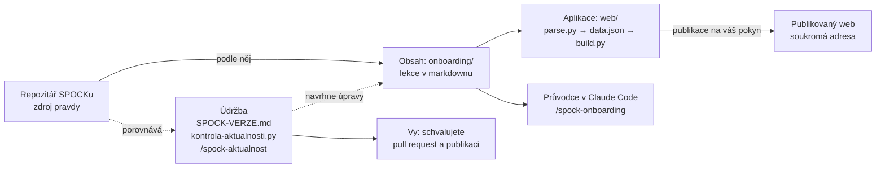

# Architektura SPOCK Tutorialu

Z čeho se tutoriál skládá, kudy teče změna od SPOCKu až na web a které části mění každá úprava. Každý pull request uvádí, kterých vrstev se týká.

## Jak to do sebe zapadá

Jediný zdroj obsahu jsou lekce v markdownu. Web i průvodce v Claude Code z nich čtou. Údržba hlídá, aby lekce odpovídaly SPOCKu.

Plné šipky: kudy teče obsah. Čárkované: údržba, která hlídá aktuálnost vůči SPOCKu.

## Kde co běží

| Co | Kde |
|---|---|
| Web tutoriálu | https://claude.ai/artifact/QtTVJKqZbLBZeEUjbPjK3c (soukromý, sdílí se z menu Sdílet) |
| Tato architektura jako stránka | https://claude.ai/artifact/JqcGMazQyWcJn7zButxsAm |
| Automatické kontroly | GitHub Actions, `.github/workflows/kontroly.yml`: při každém pull requestu a po sloučení do `main` |
| Sestavený web ke stažení | GitHub Actions → Kontroly → běh na `main` → Artifacts |
| Měsíční kontrola aktuálnosti | naplánovaná úloha Clauda, 1. v měsíci v 8:56, navázaná na jedno sezení |
| Měření průchodu a zpětná vazba | databáze stránky na claude.ai: `track/<člověk>` a `feedback/<člověk>`, vidí je jen vlastník a editoři; kód ve `web/track.js` |
| Dashboard | na webu, tlačítko Dashboard v horní liště, jen pro vlastníka. Záložky: **Lidé a průchod** a **Verze a kvalita** (testy, výkon, tokeny a historie verzí, `versions/<verze>` v databázi stránky) |
| Úkoly, které musí udělat lidé | [revize/TODO-VLASTNIK.md](revize/TODO-VLASTNIK.md) |

Web se po sloučení změny **sám nepublikuje**. Postup je ve [web/README.md](web/README.md). Verze je v patičce webu.

## Čtyři vrstvy

| Vrstva | K čemu | Soubory |
|---|---|---|
| **Obsah** | Co se učí. Mění se nejčastěji. | `materialy/bootcamp/`: zdrojová PDF z bootcampu; `onboarding/*.md`: úrovně 0–4, moduly rolí PM, PD, SWE, GM a volitelná příručka Fáze do hloubky, lekce jako krátké karty s otázkou, úkoly se štítkem kde se dělají; tahák, slovník, diagnostika, zásady, připravenost; `POKROK.md` pro průvodce v Claude Code |
| **Aplikace** | Jak se to ukazuje. Web ve stylu Duolinga. | `web/parse.py` čte lekce, `web/build.py` skládá stránku; `app.js` (cesta, lekce, kvízy, odznaky, chat se Spockem); `sim.js` (simulace SPOCK nanečisto, vysvětlivky, dotazník); `nastroje/video/` (výroba videí SPOCK krok za krokem); `track.js` (měření průchodu, zpětná vazba, dashboard vlastníka); `*.css`, `media/`. Návod v [web/README.md](web/README.md) |
| **Údržba** | Aby tutoriál nezastaral, když se SPOCK mění. | [SPOCK-VERZE.md](SPOCK-VERZE.md): vydání a commit SPOCKu; `nastroje/spock-otisk.json`: otisk všech souborů SPOCKu v této verzi; `nastroje/kontrola-aktualnosti.py`: mechanická kontrola odkazů a změn; `nastroje/e2e/journey.js`: end-to-end test webu; `nastroje/generuj-pokrok.py`: přehled pokroku z lekcí; `nastroje/kontrola-struktury.py`: seznam modulů je všude stejný; `nastroje/kontrola-odpovedi.py`: hlídá, že se správná odpověď nedá uhodnout podle délky; `nastroje/generuj-revizi.py`: kontrolní seznam pro odbornou kontrolu (`revize/`); `/spock-aktualnost`: měsíční kontrola v Claude Code |
| **Průvodci** | Kdo uživateli pomáhá. | `/spock-onboarding`: průvodce v Claude Code, zapisuje pokrok; agent **Spock průvodce** v GitHub Copilotu (`.github/agents/spock-pruvodce.agent.md`), stejná pravidla; Spock na webu: chat, který zná celý modul, ve kterém uživatel je, a přehled ostatních |

## Kudy jde která změna

Každá změna jde na vlastní větev a do pull requestu. Do hlavní větve se sloučí až po schválení. Web se publikuje zvlášť.

| Co se mění | Vrstva a kde | Co následuje |
|---|---|---|
| Text lekce, karta, úkol, kvíz | Obsah: `onboarding/*.md` (karty pod `### Karty`, `#### název`, otázka `**Otázka:**` a `- [x]`; u úkolu `- *Ověření:*` nebo `- *Co jste viděli:*` s možnostmi `- [x]`, volitelně `- *Nápověda:*` a `- *Když ne:*`) | Spustit `nastroje/kontrola-odpovedi.py` (správná odpověď nesmí být poznat podle délky), sestavit web, publikovat. Nový úkol nebo karta jen na konec lekce. |
| Vzhled nebo funkce webu | Aplikace: `web/app.js`, `sim.js`, `*.css` | Sestavit web, otestovat počítač, mobil a tmavý režim, publikovat. |
| Simulace, vysvětlivky pojmů, popisy rolí | Aplikace: `sim.js`, `app.js` | Texty jsou mimo markdown, proto je hlídá i měsíční kontrola. |
| Přejmenovaný nebo nový soubor lekce | Průvodci: `.claude/skills/spock-onboarding/SKILL.md` a `.github/agents/spock-pruvodce.agent.md` | Oba průvodci mají seznam lekcí, upravit ho v obou. |
| Nové vydání SPOCKu | Údržba: `/spock-aktualnost` | Zpráva se závažností, schválení, úprava lekcí, nový zápis v `SPOCK-VERZE.md`. |
| Chování průvodce v Claude Code | Průvodci: `.claude/skills/` | Platí od dalšího spuštění v Claude Code. |

## Pravidla, která drží tutoriál v pořádku

1. **Obsah se mění jen v markdownu.** Web se z něj sestavuje, HTML se ručně neupravuje.
2. **Nový úkol na konec lekce, nová lekce na konec modulu.** Pořadí úkolů je klíč uloženého pokroku uživatelů.
3. **Každé tvrzení o SPOCKu má oporu ve SPOCKu.** Odkazy kontroluje skript, chování se ověřuje spuštěním tasků na kopii SPOCKu.
4. **Nic se neslučuje ani nepublikuje bez schválení.** Větev, pull request, schválení, pak sloučení.
5. **Web je soukromý.** Otevře ho jen ten, s kým ho vlastník sdílí z menu stránky. Pokrok se ukládá jen v prohlížeči uživatele.

## Historie změn

S každým sloučeným pull requestem sem přibude řádek: číslo, vrstvy a co se změnilo.

| PR | Vrstvy | Co se změnilo | Sloučeno |
|---|---|---|---|
| [#34](https://github.com/TominoHav/SpockTutorial/pull/34) | Obsah | Kontakt Tomáše Havlíčka je uveden u Onboarding Tutorialu místo Metodiky (komentář Tomáše Havlíčka) | 15. 11. 2026 |
| [#33](https://github.com/TominoHav/SpockTutorial/pull/33) | Aplikace, Údržba | Čas na stránce počítá jen aktivní práci (dřív i otevřenou nečinnou stránku), čitelnější popisky v dashboardu, kontrola videí a ověření u úkolů | 15. 11. 2026 |
| [#32](https://github.com/TominoHav/SpockTutorial/pull/32) | Aplikace | Tlačítko Dashboard je na mobilu jen ikona, hlavička se vlastníkovi už neláme | 15. 11. 2026 |
| [#31](https://github.com/TominoHav/SpockTutorial/pull/31) | Aplikace | Tlačítko Zpětná vazba v horní liště místo plovoucího tlačítka, odkaz na zpětnou vazbu na konci každé lekce | 15. 11. 2026 |
| [#30](https://github.com/TominoHav/SpockTutorial/pull/30) | Obsah, Aplikace | Praktičtější tutoriál: od úrovně 1 nejdřív práce ve VS Code, 29 úkolů s ověřením z VS Code nebo otázkou Co jste viděli, odchylky agentů v dashboardu; videa SPOCK krok za krokem (dlouhé a sedm klipů po fázích, anglický komentář, české titulky) vložená do lekcí | 15. 11. 2026 |
| [#29](https://github.com/TominoHav/SpockTutorial/pull/29) | Aplikace, Údržba | Měření průchodu, zpětná vazba jako úkoly a dashboard vlastníka: návštěvy, trychtýř, kde se lidé ztrácejí, kliknutí, výkon, odhad tokenů Spocka; záložka Verze a kvalita: testy, zhoršení výkonu a náročnost na tokeny u každé verze | 15. 11. 2026 |
| [#28](https://github.com/TominoHav/SpockTutorial/pull/28) | Údržba, Aplikace | Automatické kontroly na GitHubu, verze v patičce webu, postup publikace, kontrola struktury modulů, seznam úkolů pro vlastníka | 15. 11. 2026 |
| [#27](https://github.com/TominoHav/SpockTutorial/pull/27) | Obsah, Aplikace, Údržba | Odpovědi nejdou uhodnout podle délky a pořadí, příručka a přepínač lekcí v menu u všech modulů, rozdělené dlouhé karty 2G.6, e2e průchod všemi 9 moduly | 14. 11. 2026 |
| [#26](https://github.com/TominoHav/SpockTutorial/pull/26) | Obsah, Údržba | Kontrolní seznam odborné kontroly (287 položek), scénář pilotu s nováčky, kratší úkoly v Přípravě a u PM | 14. 11. 2026 |
| [#25](https://github.com/TominoHav/SpockTutorial/pull/25) | Průvodci | Agent Spock průvodce pro GitHub Copilot ve VS Code: odpovídá z lekcí, vede úkoly a kvíz, zapisuje jen POKROK.md | 14. 11. 2026 |
| [#24](https://github.com/TominoHav/SpockTutorial/pull/24) | Aplikace | Po dokončení lekce skok na začátek další lekce, pod horní lištu (komentář Tomáše Havlíčka z mobilu) | 14. 11. 2026 |
| [#23](https://github.com/TominoHav/SpockTutorial/pull/23) | Obsah, Aplikace | Lekce 0.1: tlačítko, které pustí video přímo v lekci, a tlačítko pro SPOCK nanečisto (komentář Tomáše Havlíčka) | 14. 11. 2026 |
| [#22](https://github.com/TominoHav/SpockTutorial/pull/22) | Aplikace | Mobilní úvodní stránka: jeden sloupec, menší Spock, tlačítka přes celou šířku | 14. 11. 2026 |
| [#21](https://github.com/TominoHav/SpockTutorial/pull/21) | Průvodci | Spock dostává celý jen modul, ve kterém uživatel je, ostatní jako přehled: kontext zprávy 50–67 tisíc znaků místo 218 tisíc | 14. 11. 2026 |
| [#20](https://github.com/TominoHav/SpockTutorial/pull/20) | Obsah, Aplikace, Údržba | Revize kvízů: zásoba 8 situačních otázek na modul, losování 5 a míchání, splnění na 80 %, kvíz až po kartách, přísnější skokový test | 14. 11. 2026 |
| [#19](https://github.com/TominoHav/SpockTutorial/pull/19) | Obsah, Aplikace, Údržba | Celý tutoriál v kartách: nová úroveň 0 Poznejte SPOCK jen na webu, Příprava jako úroveň 1, Fáze do hloubky jako volitelná příručka, štítky kde se úkol dělá, e2e 68 kontrol | 14. 11. 2026 |
| [#18](https://github.com/TominoHav/SpockTutorial/pull/18) | Obsah | Data: do SPOCKu jen klasifikace C1, C2 nikdy | 14. 11. 2026 |
| [#17](https://github.com/TominoHav/SpockTutorial/pull/17) | Obsah, Aplikace, Údržba | Materiály z bootcampu: interní postup ČS, kontakty, data jen C1, brief, soubor trhu, lekce 1.4; generátor POKROK.md; ukázky kódu s kopírováním | 14. 11. 2026 |
| [#16](https://github.com/TominoHav/SpockTutorial/pull/16) | Obsah | PDF materiály z bootcampu SPOCKu (nahráno Tomášem Havlíčkem) | 14. 11. 2026 |
| [#15](https://github.com/TominoHav/SpockTutorial/pull/15) | Obsah, Aplikace, Průvodci | Kontakt: tým CoE Product Management místo Igora Tadiće ve všech lekcích, na webu i v průvodci | 14. 11. 2026 |
| [#14](https://github.com/TominoHav/SpockTutorial/pull/14) | Obsah | Kdo pomůže v lekci 0.1: tým CoE Product Management (úprava Tomáše Havlíčka) | 14. 11. 2026 |
| [#13](https://github.com/TominoHav/SpockTutorial/pull/13) | Aplikace | Odznaky a denní cíl jako upozornění v rohu místo oslavy přes celou obrazovku | 14. 11. 2026 |
| [#12](https://github.com/TominoHav/SpockTutorial/pull/12) | Aplikace, Údržba | End-to-end test webu (58 kontrol); skryté prvky se skryjí i mimo claude.ai | 14. 11. 2026 |
| [#11](https://github.com/TominoHav/SpockTutorial/pull/11) | Aplikace | Úklid webu: odstraněné nevybrané návrhy a nepoužité styly, vzhled beze změny | 14. 11. 2026 |
| [#10](https://github.com/TominoHav/SpockTutorial/pull/10) | Údržba | Otisk souborů SPOCKu: kontrola aktuálnosti funguje i bez historie gitu | 14. 11. 2026 |
| [#9](https://github.com/TominoHav/SpockTutorial/pull/9) | Údržba | Tento dokument o architektuře tutoriálu | 14. 11. 2026 |
| [#8](https://github.com/TominoHav/SpockTutorial/pull/8) | Obsah, Aplikace | Vysvětlení architektury SPOCKu v lekci GM 2G.6 a schéma na webu | 14. 11. 2026 |
| [#7](https://github.com/TominoHav/SpockTutorial/pull/7) | Aplikace, Údržba | Web se poprvé sestavuje z repozitáře; SPOCK-VERZE.md, kontrolní skript, /spock-aktualnost | 14. 11. 2026 |
| [#6](https://github.com/TominoHav/SpockTutorial/pull/6) | Obsah, Průvodci | Blok „Kdo co hlídá“ v Základech, lekce 2G.6 pro GM, zkratky PM, PD, SWE, GM | 14. 11. 2026 |
| [#5](https://github.com/TominoHav/SpockTutorial/pull/5) | Obsah | Odebrání dodaného materiálu a návrat z C189 (druhý praktický test) | 14. 11. 2026 |
| [#4](https://github.com/TominoHav/SpockTutorial/pull/4) | Obsah | Doplnění podle praktického testu: změna know-how, screening A1b, datování, ukončení běhu | 14. 11. 2026 |
| [#3](https://github.com/TominoHav/SpockTutorial/pull/3) | Obsah | Zjednodušení lekce 0.1 a kontakty, kdo pomůže | 14. 11. 2026 |
| [#2](https://github.com/TominoHav/SpockTutorial/pull/2) | Obsah, Průvodci | Role Guild Master, úroveň 1b podle specifikací fází, rozšířená Příprava | 14. 11. 2026 |
| [#1](https://github.com/TominoHav/SpockTutorial/pull/1) | Obsah, Průvodci | Přepis z builderského na uživatelský onboarding | 13. 11. 2026 |

Úpravy webu do 14. 11. 2026 (styl Duolinga, cesta v levém sloupci, simulace, odznaky, video) vznikaly mimo repozitář a jsou v něm souhrnně od #7.
