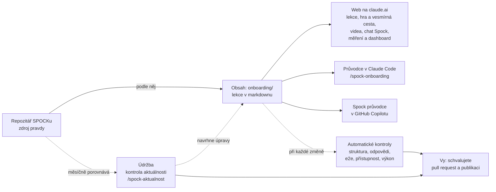

# Architektura SPOCK Tutorialu

Z čeho se tutoriál skládá, kudy teče změna od SPOCKu až na web a které části mění každá úprava. Každý pull request uvádí, kterých vrstev se týká.

## Jak to do sebe zapadá

Jediný zdroj obsahu jsou lekce v markdownu. Web i oba průvodci z nich čtou. Údržba hlídá, aby lekce odpovídaly SPOCKu a web fungoval.

Plné šipky: kudy teče obsah. Čárkované: údržba a kontroly, které hlídají aktuálnost a kvalitu.

## Kde co běží

| Co | Kde |
|---|---|
| Web tutoriálu | https://claude.ai/artifact/QtTVJKqZbLBZeEUjbPjK3c (soukromý, sdílí se z menu Sdílet) |
| Tato architektura jako stránka | https://claude.ai/artifact/JqcGMazQyWcJn7zButxsAm |
| Automatické kontroly | GitHub Actions, `.github/workflows/kontroly.yml`: při každém pull requestu a po sloučení do `main` |
| Sestavený web ke stažení | GitHub Actions → Kontroly → běh na `main` → Artifacts |
| Měsíční kontrola aktuálnosti | naplánovaná úloha Clauda, 1. v měsíci v 8:56, navázaná na jedno sezení |
| Měření průchodu a zpětná vazba | databáze stránky na claude.ai: `track/<člověk>` (posledních 300 kroků) a `feedback/<člověk>`, vidí je jen vlastník a editoři; kód ve `web/track.js` |
| Dashboard | na webu, tlačítko Dashboard v horní liště, jen pro vlastníka. Záložky: **Lidé a průchod** a **Verze a kvalita** (e2e testy, přístupnost, výkon, tokeny a historie verzí, `versions/<verze>` v databázi stránky) |
| Pokrok a hra uživatele | v prohlížeči (`localStorage`) a pod účtem uživatele v databázi stránky (`data/users/<člověk>/progress`, vidí ho jen on): odškrtnuté úkoly, XP, hodnost, série, vzhled Spocka, postavička, poslední lekce. Při otevření se obojí sloučí, změna se do 2 s uloží. Kód: `pLoad`, `pPush` ve `web/track.js` |
| Úkoly, které musí udělat lidé | [revize/TODO-VLASTNIK.md](revize/TODO-VLASTNIK.md) |

Web se po sloučení změny **sám nepublikuje**. Postup je ve [web/README.md](web/README.md). Verze je v patičce webu.

## Čtyři vrstvy

| Vrstva | K čemu | Soubory |
|---|---|---|
| **Obsah** | Co se učí. Mění se nejčastěji. | `materialy/bootcamp/`: zdrojová PDF z bootcampu; `onboarding/*.md`: úrovně 0–3 pro všechny, modul role na úrovni 2 (PM, PD, SWE, GM), úroveň 4 Superuser jen pro Guild Mastery a volitelná příručka Fáze do hloubky; lekce jako krátké karty s otázkou, úkoly se štítkem, kde se dělají; tahák, slovník, diagnostika, zásady, připravenost; `POKROK.md` pro průvodce v Claude Code |
| **Aplikace** | Jak se to ukazuje. | `web/parse.py` čte lekce, `web/build.py` skládá jednu stránku (styly i JavaScript bez komentářů, písmo až po vykreslení, zprávy z testů pro dashboard). `app.js`: lekce, kvízy a skokový test, **opakování chyb** (`S.rev`, `REV_DAYS`), **vstupní test** (`place`), **novinky ve SPOCKu** (`NOVINKY`), **expresní cesta** (`EXPRESS`: sedm kroků za zhruba 1 h 40 min, odznak Expres; po výběru role rozcestí v banneru, pak banner vede jen dalším krokem), chat se Spockem, **hra** (XP, hodnosti s odměnami, vzhledy Spocka, denní výzvy, zmrazení série, odznaky), **vesmírná cesta** (mapa světů a překážek, postavička, minihry, shrnutí úrovně, šatna a příběh s oslavou v cíli), zvuk a mluvený komentář. `sim.js`: simulace SPOCK nanečisto, vysvětlivky pojmů, dotazník. `track.js`: měření průchodu, zpětná vazba, dashboard vlastníka, **tým** (`tymy/`, `clenove/`: kód týmu, souhrn postupu členů), **offline režim** (štítek Offline, fronta zpětné vazby v zařízení, po připojení znovu připojení k účtu a odeslání pokroku). `nastroje/video/`: výroba videí. `*.css`, `media/`. Návod v [web/README.md](web/README.md) |
| **Údržba** | Aby tutoriál nezastaral a nerozbil se. | [SPOCK-VERZE.md](SPOCK-VERZE.md): vydání a commit SPOCKu; `nastroje/spock-otisk.json`: otisk všech souborů SPOCKu v této verzi; `nastroje/kontrola-aktualnosti.py`: mechanická kontrola odkazů a změn; **testy webu** v `nastroje/e2e/` (viz níže); `nastroje/generuj-pokrok.py`: přehled pokroku z lekcí; `nastroje/kontrola-struktury.py`: seznam modulů je všude stejný; `nastroje/kontrola-odpovedi.py`: správná odpověď se nedá uhodnout podle délky; `nastroje/generuj-revizi.py`: kontrolní seznam pro odbornou kontrolu (`revize/`); `/spock-aktualnost`: měsíční kontrola v Claude Code |
| **Průvodci** | Kdo uživateli pomáhá. | `/spock-onboarding`: průvodce v Claude Code, zapisuje pokrok; agent **Spock průvodce** v GitHub Copilotu (`.github/agents/spock-pruvodce.agent.md`), stejná pravidla; Spock na webu: chat, který zná celý modul, ve kterém uživatel je, a přehled ostatních |

## Automatické testy webu

Běží na GitHubu při každém pull requestu a po sloučení do `main`. Když kterýkoli selže, kontroly jsou červené. Jdou pustit i ručně (postup ve [web/README.md](web/README.md)).

| Test | Co hlídá | Kolik kontrol |
|---|---|---|
| `nastroje/e2e/journey.js` | Cesta uživatele na počítači i mobilu (souběžně): simulace, role, karty, úkoly s ověřením, kvíz, zámky a skokový test, všech 9 modulů, opora, chat, dashboard a jeho analýzy, hra, vesmírná cesta, minihry, shrnutí, příběh, mluvený komentář, zmrazení série, pokrok v účtu | 209 |
| `nastroje/e2e/scenare.js` | Offline režim (výpadek za běhu i start bez sítě), výpadek chatu, nedostupná databáze, chybějící právo zápisu, pokrok ze dvou zařízení, ovládání klávesnicí (Tab, Enter, Escape, viditelné zaměření), tablet, tablet na šířku, široký monitor, tmavý režim, platnost videí | 119 |
| `nastroje/e2e/pristupnost.js` | Průchod za každou roli; WCAG 2 A a AA (axe-core) na sedmi stránkách a na úvodu se zapnutou expresní cestou, v dashboardu, simulaci, minihře a příběhu, světlý i tmavý režim; dotykové plochy na mobilu | 88 |
| `nastroje/e2e/vykon.js` | Rozpočty: velikost stránky (700 kB, po kompresi 230 kB), první vykreslení, vykreslení lekce a opory, procesor po 15 s nečinnosti, počet prvků; dashboard s 500 smyšlenými lidmi | 10 |
| Safari (WebKit) | `journey.js` v jádru Safari na počítači i mobilu (iPhone, iPad, Mac). Chrome a Edge pokrývá Chromium | 2 × 101 |

Testovací prostředí (smyšlená databáze, vlastník, chat) je v `nastroje/e2e/fixture.js`. Každý scénář běží ve vlastním prohlížeči: když jeden spadne, ostatní doběhnou a selhání se zapíše. U každého neprošlého testu se uloží snímek obrazovky do `web/dist/e2e-chyby/` a na GitHubu je ke stažení u běhu kontrol. Testy nečekají pevné pauzy, ale na vykreslení stránky. Testovací háčky (`window.__kviz`) jsou jen v testovacím sestavení, ne ve stránce pro uživatele. Na GitHubu běží čtyři úlohy souběžně (obsah, web, přístupnost a výkon, Safari).

Každý test zapíše zprávu do `web/dist/` a `build.py` ji přiloží do stránky, jen když test běžel nad stejnými zdroji. Dashboard pak na záložce **Verze a kvalita** ukáže, co neprošlo nebo neběželo.

Co testy neověří: jak zní mluvený komentář na konkrétním zařízení, jak rychlá je stránka u skutečných lidí (to měří dashboard) a jestli lekcím rozumí nováček (na to je pilot v `revize/PILOT-S-NOVACKY.md`).

## Kudy jde která změna

Každá změna jde na vlastní větev a do pull requestu. Do hlavní větve se sloučí až po schválení. Web se publikuje zvlášť.

| Co se mění | Vrstva a kde | Co následuje |
|---|---|---|
| Text lekce, karta, úkol, kvíz | Obsah: `onboarding/*.md` (karty pod `### Karty`, `#### název`, otázka `**Otázka:**` a `- [x]`; u úkolu `- *Ověření:*` nebo `- *Co jste viděli:*` s možnostmi `- [x]`, volitelně `- *Nápověda:*` a `- *Když ne:*`) | Spustit `nastroje/kontrola-odpovedi.py` (správná odpověď nesmí být poznat podle délky), sestavit web, publikovat. Nový úkol nebo karta jen na konec lekce. |
| Vzhled nebo funkce webu | Aplikace: `web/app.js`, `sim.js`, `*.css` | Sestavit web, pustit všechny tři testy z `nastroje/e2e/`, k nové funkci přidat kontrolu do `journey.js`, publikovat. |
| Hra: body, hodnosti, odměny, světy a překážky | Aplikace: `web/app.js` (`XP`, `RANKS_ALL`, `SKINS`, `QUESTS`, `WORLDS`) | Přepočítat, že na nejvyšší hodnost dosáhne každá role na své cestě; pustit testy. |
| Simulace, vysvětlivky pojmů, popisy rolí | Aplikace: `sim.js`, `app.js` | Texty jsou mimo markdown, proto je hlídá i měsíční kontrola. |
| Přejmenovaný nebo nový soubor lekce | Průvodci: `.claude/skills/spock-onboarding/SKILL.md` a `.github/agents/spock-pruvodce.agent.md` | Oba průvodci mají seznam lekcí, upravit ho v obou. |
| Nové vydání SPOCKu | Údržba: `/spock-aktualnost` | Zpráva se závažností, schválení, úprava lekcí, nový zápis v `SPOCK-VERZE.md`. |
| Chování průvodce v Claude Code | Průvodci: `.claude/skills/` | Platí od dalšího spuštění v Claude Code. |

## Pravidla, která drží tutoriál v pořádku

1. **Obsah se mění jen v markdownu.** Web se z něj sestavuje, HTML se ručně neupravuje.
2. **Nový úkol na konec lekce, nová lekce na konec modulu.** Pořadí úkolů je klíč uloženého pokroku uživatelů.
3. **Každé tvrzení o SPOCKu má oporu ve SPOCKu.** Odkazy kontroluje skript, odpovědi u ověření z VS Code jsou z kopie SPOCKu.
4. **Nic se neslučuje ani nepublikuje bez schválení.** Větev, pull request, zelené kontroly, schválení, pak sloučení.
5. **Pokrok se neztrácí.** Ukládá se pod účtem člověka; slučování v `pMerge` nikdy nemaže hotové úkoly, jen přidává.
6. **Web projde testy přístupnosti a výkonu.** Kontrast a dotykové plochy podle WCAG 2 AA ve světlém i tmavém režimu, rozpočty na velikost a rychlost. Nová barva nebo větší stránka se pozná hned v kontrolách.
7. **Úroveň 4 je jen pro Guild Mastery.** Ostatní role ji nevidí a jejich cesta i „Hotovo %“ končí úrovní 3.
8. **Web je soukromý.** Otevře ho jen ten, s kým ho vlastník sdílí z menu stránky. Pokrok se ukládá v prohlížeči a pod účtem uživatele (vidí ho jen on), průchod se měří jmenovitě a vidí ho jen vlastník a editoři.

## Historie změn

S každým sloučeným pull requestem sem přibude řádek: číslo, vrstvy a co se změnilo.

| PR | Vrstvy | Co se změnilo | Sloučeno |
|---|---|---|---|
| [#38](https://github.com/TominoHav/SpockTutorial/pull/38) | Aplikace | Lehčí úvodní stránka: SPOCK nanečisto jen jednou, video v okně, Co je SPOCK sbalené, kratší texty, kompaktní role a opora na mobilu | 15. 11. 2026 |
| [#74](https://github.com/TominoHav/SpockTutorial/pull/74) | Obsah | Ověření u dalších 26 úkolů (55 z 93): u čtení ukázkových běhů otázka s jednou odpovědí z repozitáře SPOCKu, u vlastního běhu „Co jste viděli“ podle dokumentace; úkoly na psaní a vysvětlování zůstávají bez ověření | 17. 11. 2026 |
| [#72](https://github.com/TominoHav/SpockTutorial/pull/72) | Aplikace | Kvíz u překážky: kvíz modulu v podobě minihry (vesmír, loď letí k planetě úrovně, Spock radí), otázky z kvízu; smazáno shrnutí úrovně a samostatná minihra; kvíz jen pod poslední lekcí modulu, po splnění jedno tlačítko Pokračovat; oprava odkazu na smazanou Připravenost a kontrastu chybové odpovědi | 17. 11. 2026 |
| [#71](https://github.com/TominoHav/SpockTutorial/pull/71) | Aplikace, Obsah | Konec lekce prakticky: lekce končí úkolem „Teď to zkuste (ve SPOCKu)“ a blokem „Co si odnést do práce“ (pravidla z vysvětlení karet lekce, ukážou se až po kartách); praktické lekce dál začínají prací ve VS Code | 17. 11. 2026 |
| [#70](https://github.com/TominoHav/SpockTutorial/pull/70) | Aplikace | Méně času a opory: pryč „30 minut denně“, časy v menu, v průvodci modulem a u bloků lekcí a denní cíl XP (čas zůstává na rozcestí, u lekce a u expresu); Opora jen Tahák, Když něco nejde a Slovníček, pod Další Odznaky a profil, Tým a Příručka; smazány SPOCK v kostce, Připravenost (dotazník je na stránce Odznaky a profil), nanečisto a jiné role v menu | 17. 11. 2026 |
| [#69](https://github.com/TominoHav/SpockTutorial/pull/69) | Aplikace, Údržba | První použití zase podle původní verze: bez uvítacího okna, role se vybírá na stránce a pod ní je rozbalené Co je SPOCK; po výběru role rozcestí se dvěma rovnocennými kartami jako ve videu a Co je SPOCK hned pod bannerem; JavaScript se při sestavení zmenšuje nástrojem esbuild (stránka 699 → 640 kB) | 17. 11. 2026 |
| [#68](https://github.com/TominoHav/SpockTutorial/pull/68) | Aplikace | Úvodní stránka bez karet Dnešní výzvy a Učte se s týmem: výzvy jsou na stránce Odznaky a profil, tým v menu | 17. 11. 2026 |
| [#67](https://github.com/TominoHav/SpockTutorial/pull/67) | Aplikace | Přizpůsobení: opakování netrefených karet s odstupem (1, 3, 7, 14 dní), vstupní test z úrovně 0 (8 otázek, splní teorii a odemkne Přípravu, úkoly zůstávají), novinky ve SPOCKu po nové verzi (`NOVINKY` v app.js); obojí jako zvonek v horní liště s vyskakovacím upozorněním. Opora zeštíhlená: v menu jen tahák, když něco nejde, slovníček a tým, zbytek pod Další, dashboard pod Jen pro vás; na úvodu tři opory. Horní lišta seskupená: role · pokrok (procenta, XP, série) | zvonek, zpětná vazba, dashboard. Celá cesta jako hlavní volba, expres jako vedlejší. Uvítání: po videu výběr role přímo v okně | 17. 11. 2026 |
| [#66](https://github.com/TominoHav/SpockTutorial/pull/66) | Aplikace | Tým: založení týmu s kódem, připojení kódem se souhlasem se sdílením souhrnu, přehled postupu členů (role, hodnost, XP, postup, kde jsou, série, poslední aktivita), upozornění na lidi bez aktivity, odebrání člena, zrušení a opuštění týmu; databáze `tymy/` a `clenove/` | 17. 11. 2026 |
| [#65](https://github.com/TominoHav/SpockTutorial/pull/65) | Aplikace | Uvítání: místo dlouhého odstavce krátký podtitulek „Podívejte se, co vás čeká. Necelé 2 minuty.“; křížek viditelný i ve světlém režimu | 17. 11. 2026 |
| [#64](https://github.com/TominoHav/SpockTutorial/pull/64) | Aplikace, Údržba | Pitch video „Onboarding do SPOCKu za necelé dvě minuty“ (s odměnami ve hře a náznakem finále): uvítání při prvním otevření (jednou, nepouští se samo, Přeskočit) a tlačítka „Co vás čeká“ a „Co je SPOCK“ na úvodní stránce; výroba videa ve dvou verzích (vedení, uživatelé) v `nastroje/video/pitch/` | 17. 11. 2026 |
| [#63](https://github.com/TominoHav/SpockTutorial/pull/63) | Aplikace | Nadtitulek banneru: místo „PDE“ srozumitelné „Onboarding do SPOCKu“ (logo PDE zůstává) | 17. 11. 2026 |
| [#62](https://github.com/TominoHav/SpockTutorial/pull/62) | Aplikace | Logo PDE Journey v banneru úvodní stránky vedle nadtitulku (nováček i vracející se), překreslené do SVG | 17. 11. 2026 |
| [#61](https://github.com/TominoHav/SpockTutorial/pull/61) | Aplikace | Ikona aplikace pro plochu telefonu a záložku prohlížeče (hlava Spocka na hvězdném nebi): vložená ve stránce, soubory a manifest pro vlastní server ve `web/ikona/` | 17. 11. 2026 |
| [#60](https://github.com/TominoHav/SpockTutorial/pull/60) | Údržba, Aplikace | Měření načtení v testu: medián ze 7 načtení o samotě místo jednoho měření za souběžného běhu (hlásilo zhoršení, které nebylo); dashboard srovnává jen stejně měřené verze; sestavení vypouští řádky s komentáři v JavaScriptu (stránka o 12 kB menší) | 17. 11. 2026 |
| [#59](https://github.com/TominoHav/SpockTutorial/pull/59) | Aplikace | Offline režim: bez sítě jdou lekce, kvízy a hra dál a pokrok se ukládá v zařízení; štítek Offline v hlavičce, zpětná vazba ve frontě, chat vysvětlí výpadek a nechá otázku, video ukáže hlášku; po připojení se aplikace sama připojí k účtu a odešle pokrok, měření i frontu. Scénáře offline a start bez sítě | 17. 11. 2026 |
| [#58](https://github.com/TominoHav/SpockTutorial/pull/58) | Aplikace | Expresní cesta v banneru: po výběru role rozcestí Celá cesta × Expresní start, potom jedno hlavní tlačítko s dalším krokem, postup v sedmi dílcích a seznam kroků k rozbalení; samostatná karta zrušena; audit přístupnosti i se zapnutým expresem | 17. 11. 2026 |
| [#57](https://github.com/TominoHav/SpockTutorial/pull/57) | Aplikace | Kontrast zelené značky zlepšení v dashboardu Verze a kvalita | 17. 11. 2026 |
| [#56](https://github.com/TominoHav/SpockTutorial/pull/56) | Aplikace | Expresní cesta na úvodu: sedm kroků za zhruba 1 h 40 min (SPOCK nanečisto, lekce 0.1 jen karty, video, objednání přístupů, tahák), odpočet zbývajícího času, odznak a 50 XP za dokončení, pokrok se ukládá pod účtem; scénář v `scenare.js` | 17. 11. 2026 |
| [#55](https://github.com/TominoHav/SpockTutorial/pull/55) | Údržba | Revize testů: nezávislé scénáře, snímky při selhání, čekání na vykreslení místo pauz, háčky jen v testech, nové scénáře (výpadky, dvě zařízení, klávesnice, tablet, tmavý režim, videa), přístupnost dashboardu a příběhu, Safari, souběžné úlohy; opravy nalezených chyb | 17. 11. 2026 |
| [#54](https://github.com/TominoHav/SpockTutorial/pull/54) | Aplikace | Pokrok pod účtem: ukládá se do soukromé části databáze, při otevření na jiném zařízení se sloučí, úvod nabídne pokračovat v poslední lekci; paměť kroků 300; TODO pro přesun na vlastní server | 17. 11. 2026 |
| [#53](https://github.com/TominoHav/SpockTutorial/pull/53) | Aplikace | Dashboard pro 500 lidí: mezipaměť cest a analýzy, seznamy po 50, živá aktualizace stahuje jen změněné záznamy a překreslí jen při nových datech; výkonový test dashboardu s 500 lidmi | 17. 11. 2026 |
| [#52](https://github.com/TominoHav/SpockTutorial/pull/52) | Aplikace | Pohyb a problémová místa: filtry (období, role, zařízení), přehledová čísla s vysvětlením, grafy (mapa pohybu, kam lidé došli, problémová místa, aktivita v čase, délka sezení, typy chování) s popisky, výběr místa zúží cesty lidí, živá aktualizace každých 30 s | 17. 11. 2026 |
| [#51](https://github.com/TominoHav/SpockTutorial/pull/51) | Aplikace | Dashboard: nová záložka Pohyb a problémová místa (automatické závěry, problémová místa s důvody, kam až lidé došli, přechody, vstupy a odchody, vzorce, bloudění, cesta každého člověka krok za krokem) a bohatší sběr kroků | 17. 11. 2026 |
| [#50](https://github.com/TominoHav/SpockTutorial/pull/50) | Aplikace | Dashboard: kdy lidé tutoriál používají (první a poslední návštěva s časem, sezení od–do u každého člověka, přehled den × hodina) | 17. 11. 2026 |
| [#49](https://github.com/TominoHav/SpockTutorial/pull/49) | Údržba | Automatické testy přístupnosti a výkonu v kontrolách na GitHubu a v dashboardu, oprava kontrastu diagnostiky v tmavém režimu, aktualizovaná architektura | 16. 11. 2026 |
| [#48](https://github.com/TominoHav/SpockTutorial/pull/48) | Aplikace | Výkon a přístupnost: rychlejší vykreslení lekce, pozastavení animací při nečinnosti a mimo obrazovku, kontrast podle WCAG AA, jazyk stránky, větší dotykové plochy na mobilu | 16. 11. 2026 |
| [#47](https://github.com/TominoHav/SpockTutorial/pull/47) | Aplikace | Oslavné finále cesty: scéna Setkání se Spockem s ohňostrojem, paprsky, posádkou agentů a fanfárou, medaile absolventa, společný odlet v lodi, správné skloňování | 16. 11. 2026 |
| [#46](https://github.com/TominoHav/SpockTutorial/pull/46) | Aplikace | Přehlednější mobil: lišta úrovní (jen kroky a jeden řádek s názvem a procenty), statistiky a profil v mřížce, mapa s procenty, kratší hlavička; doplněné e2e scénáře (oslava úrovně, mluvený komentář, zmrazení série) | 16. 11. 2026 |
| [#45](https://github.com/TominoHav/SpockTutorial/pull/45) | Aplikace | Vzhledy Spocka podle hodnosti: vlastní barvy a doplněk (šátek, sluchátka, medaile, hvězdy, koruna s pláštěm, trysky) místo přebarvení | 16. 11. 2026 |
| [#44](https://github.com/TominoHav/SpockTutorial/pull/44) | Aplikace | Vesmírná cesta: světy a překážky, postavička na mapě, šatna a ozvučený příběh cesty; u překážek přeskočitelné minihry, po každé úrovni přeskočitelné shrnutí | 16. 11. 2026 |
| [#43](https://github.com/TominoHav/SpockTutorial/pull/43) | Aplikace | Hra: postup v hodnostech s odměnami (vzhledy Spocka, zmrazení série), tři denní výzvy s truhlou, shrnutí po lekci, oslavy povýšení a sérií | 16. 11. 2026 |
| [#42](https://github.com/TominoHav/SpockTutorial/pull/42) | Obsah | Úroveň 4 Superuser jen pro Guild Mastery; ostatním rolím cesta končí úrovní 3. Lekce 3.6: co výstup dokazuje a jak nahlásit nález. Hra: odznak Cesta hotová, nejvyšší hodnost Mistr na 1700 XP. Opora podle změn | 16. 11. 2026 |
| [#41](https://github.com/TominoHav/SpockTutorial/pull/41) | Aplikace | Výkon: písmo neblokuje první vykreslení, data lekcí přes JSON.parse, styly bez komentářů a mezer, videa se nenačítají předem | 16. 11. 2026 |
| [#40](https://github.com/TominoHav/SpockTutorial/pull/40) | Obsah | GM modul pro všech pět oblastí know-how (vlastní ČS, osoby zatím nejmenovány), lekce 1.5 rozdělena na 1.5 a 1.6, kratší karty v 2G.6 | 15. 11. 2026 |
| [#39](https://github.com/TominoHav/SpockTutorial/pull/39) | Aplikace | Revize desktopu i mobilu: hlášky po jedné na jednom místě, sbalený postup úkolů, příkazy kopírovatelné kliknutím, průvodce modulem jen u první lekce, chat na místě Spocka, lehčí profil na úvodu | 15. 11. 2026 |
| [#37](https://github.com/TominoHav/SpockTutorial/pull/37) | Údržba | Architektura aktuální: schéma s oběma průvodci, webem s dashboardem a automatickými kontrolami, upravená pravidla; stránka s architekturou čitelná na mobilu | 15. 11. 2026 |
| [#36](https://github.com/TominoHav/SpockTutorial/pull/36) | Aplikace | Kontakty na úvodní stránce: řádky SPOCK a Spock spojené do jednoho | 15. 11. 2026 |
| [#35](https://github.com/TominoHav/SpockTutorial/pull/35) | Obsah | Kontakty: řádek Metodika nahrazen řádkem SPOCK (CoE Product Management a CoE Product Design) | 15. 11. 2026 |
| [#34](https://github.com/TominoHav/SpockTutorial/pull/34) | Obsah | Kontakty: Tomáš Havlíček u Onboarding Tutorialu, metodika patří týmu CoE Product Management (komentář Tomáše Havlíčka) | 15. 11. 2026 |
| [#33](https://github.com/TominoHav/SpockTutorial/pull/33) | Aplikace, Údržba | Čas na stránce počítá jen aktivní práci (dřív i otevřenou nečinnou stránku), čitelnější popisky v dashboardu, kontrola videí a ověření u úkolů | 15. 11. 2026 |
| [#32](https://github.com/TominoHav/SpockTutorial/pull/32) | Aplikace | Tlačítko Dashboard je na mobilu jen ikona, hlavička se vlastníkovi už neláme | 15. 11. 2026 |
| [#31](https://github.com/TominoHav/SpockTutorial/pull/31) | Aplikace | Tlačítko Zpětná vazba v horní liště místo plovoucího tlačítka, odkaz na zpětnou vazbu na konci každé lekce | 15. 11. 2026 |
| [#30](https://github.com/TominoHav/SpockTutorial/pull/30) | Obsah, Aplikace | Praktičtější tutoriál: od úrovně 1 nejdřív práce ve VS Code, 29 úkolů s ověřením z VS Code nebo otázkou Co jste viděli, odchylky agentů v dashboardu; videa SPOCK krok za krokem (dlouhé a sedm klipů po fázích, anglický komentář, české titulky) vložená do lekcí | 15. 11. 2026 |
| [#29](https://github.com/TominoHav/SpockTutorial/pull/29) | Aplikace, Údržba | Měření průchodu, zpětná vazba jako úkoly a dashboard vlastníka: návštěvy, trychtýř, kde se lidé ztrácejí, kliknutí, výkon, odhad tokenů Spocka; záložka Verze a kvalita: testy, zhoršení výkonu a náročnost na tokeny u každé verze | 15. 11. 2026 |
| [#28](https://github.com/TominoHav/SpockTutorial/pull/28) | Údržba, Aplikace | Automatické kontroly na GitHubu, verze v patičce webu, postup publikace, kontrola struktury modulů, seznam úkolů pro vlastníka | 15. 11. 2026 |
| [#27](https://github.com/TominoHav/SpockTutorial/pull/27) | Obsah, Aplikace, Údržba | Odpovědi nejdou uhodnout podle délky a pořadí, příručka a přepínač lekcí v menu u všech modulů, rozdělené dlouhé karty 2G.6, e2e průchod všemi 9 moduly | 14. 11. 2026 |
| [#26](https://github.com/TominoHav/SpockTutorial/pull/26) | Obsah, Údržba | Kontrolní seznam odborné kontroly (287 položek), scénář pilotu s nováčky, kratší úkoly v Přípravě a u PM | 14. 11. 2026 |
| [#25](https://github.com/TominoHav/SpockTutorial/pull/25) | Průvodci | Agent Spock průvodce pro GitHub Copilot ve VS Code: odpovídá z lekcí, vede úkoly a kvíz, zapisuje jen POKROK.md | 14. 11. 2026 |
| [#24](https://github.com/TominoHav/SpockTutorial/pull/24) | Aplikace | Po dokončení lekce skok na začátek další lekce, pod horní lištu (komentář Tomáše Havlíčka z mobilu) | 14. 11. 2026 |
| [#23](https://github.com/TominoHav/SpockTutorial/pull/23) | Obsah, Aplikace | Lekce 0.1: tlačítko, které pustí video přímo v lekci, a tlačítko pro SPOCK nanečisto (komentář Tomáše Havlíčka) | 14. 11. 2026 |
| [#22](https://github.com/TominoHav/SpockTutorial/pull/22) | Aplikace | Mobilní úvodní stránka: jeden sloupec, menší Spock, tlačítka přes celou šířku | 14. 11. 2026 |
| [#21](https://github.com/TominoHav/SpockTutorial/pull/21) | Průvodci | Spock dostává celý jen modul, ve kterém uživatel je, ostatní jako přehled: kontext zprávy 50–67 tisíc znaků místo 218 tisíc | 14. 11. 2026 |
| [#20](https://github.com/TominoHav/SpockTutorial/pull/20) | Obsah, Aplikace, Údržba | Revize kvízů: zásoba 8 situačních otázek na modul, losování 5 a míchání, splnění na 80 %, kvíz až po kartách, přísnější skokový test | 14. 11. 2026 |
| [#19](https://github.com/TominoHav/SpockTutorial/pull/19) | Obsah, Aplikace, Údržba | Celý tutoriál v kartách: nová úroveň 0 Poznejte SPOCK jen na webu, Příprava jako úroveň 1, Fáze do hloubky jako volitelná příručka, štítky kde se úkol dělá, e2e 68 kontrol | 14. 11. 2026 |
| [#18](https://github.com/TominoHav/SpockTutorial/pull/18) | Obsah | Data: do SPOCKu jen klasifikace C1, C2 nikdy | 14. 11. 2026 |
| [#17](https://github.com/TominoHav/SpockTutorial/pull/17) | Obsah, Aplikace, Údržba | Materiály z bootcampu: interní postup ČS, kontakty, data jen C1, brief, soubor trhu, lekce 1.4; generátor POKROK.md; ukázky kódu s kopírováním | 14. 11. 2026 |
| [#16](https://github.com/TominoHav/SpockTutorial/pull/16) | Obsah | PDF materiály z bootcampu SPOCKu (nahráno Tomášem Havlíčkem) | 14. 11. 2026 |
| [#15](https://github.com/TominoHav/SpockTutorial/pull/15) | Obsah, Aplikace, Průvodci | Kontakt: tým CoE Product Management místo Igora Tadiće ve všech lekcích, na webu i v průvodci | 14. 11. 2026 |
| [#14](https://github.com/TominoHav/SpockTutorial/pull/14) | Obsah | Kdo pomůže v lekci 0.1: tým CoE Product Management (úprava Tomáše Havlíčka) | 14. 11. 2026 |
| [#13](https://github.com/TominoHav/SpockTutorial/pull/13) | Aplikace | Odznaky a denní cíl jako upozornění v rohu místo oslavy přes celou obrazovku | 14. 11. 2026 |
| [#12](https://github.com/TominoHav/SpockTutorial/pull/12) | Aplikace, Údržba | End-to-end test webu (58 kontrol); skryté prvky se skryjí i mimo claude.ai | 14. 11. 2026 |
| [#11](https://github.com/TominoHav/SpockTutorial/pull/11) | Aplikace | Úklid webu: odstraněné nevybrané návrhy a nepoužité styly, vzhled beze změny | 14. 11. 2026 |
| [#10](https://github.com/TominoHav/SpockTutorial/pull/10) | Údržba | Otisk souborů SPOCKu: kontrola aktuálnosti funguje i bez historie gitu | 14. 11. 2026 |
| [#9](https://github.com/TominoHav/SpockTutorial/pull/9) | Údržba | Tento dokument o architektuře tutoriálu | 14. 11. 2026 |
| [#8](https://github.com/TominoHav/SpockTutorial/pull/8) | Obsah, Aplikace | Vysvětlení architektury SPOCKu v lekci GM 2G.6 a schéma na webu | 14. 11. 2026 |
| [#7](https://github.com/TominoHav/SpockTutorial/pull/7) | Aplikace, Údržba | Web se poprvé sestavuje z repozitáře; SPOCK-VERZE.md, kontrolní skript, /spock-aktualnost | 14. 11. 2026 |
| [#6](https://github.com/TominoHav/SpockTutorial/pull/6) | Obsah, Průvodci | Blok „Kdo co hlídá“ v Základech, lekce 2G.6 pro GM, zkratky PM, PD, SWE, GM | 14. 11. 2026 |
| [#5](https://github.com/TominoHav/SpockTutorial/pull/5) | Obsah | Odebrání dodaného materiálu a návrat z C189 (druhý praktický test) | 14. 11. 2026 |
| [#4](https://github.com/TominoHav/SpockTutorial/pull/4) | Obsah | Doplnění podle praktického testu: změna know-how, screening A1b, datování, ukončení běhu | 14. 11. 2026 |
| [#3](https://github.com/TominoHav/SpockTutorial/pull/3) | Obsah | Zjednodušení lekce 0.1 a kontakty, kdo pomůže | 14. 11. 2026 |
| [#2](https://github.com/TominoHav/SpockTutorial/pull/2) | Obsah, Průvodci | Role Guild Master, úroveň 1b podle specifikací fází, rozšířená Příprava | 14. 11. 2026 |
| [#1](https://github.com/TominoHav/SpockTutorial/pull/1) | Obsah, Průvodci | Přepis z builderského na uživatelský onboarding | 13. 11. 2026 |

Úpravy webu do 14. 11. 2026 (styl Duolinga, cesta v levém sloupci, simulace, odznaky, video) vznikaly mimo repozitář a jsou v něm souhrnně od #7.
